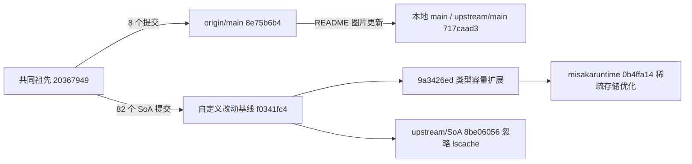
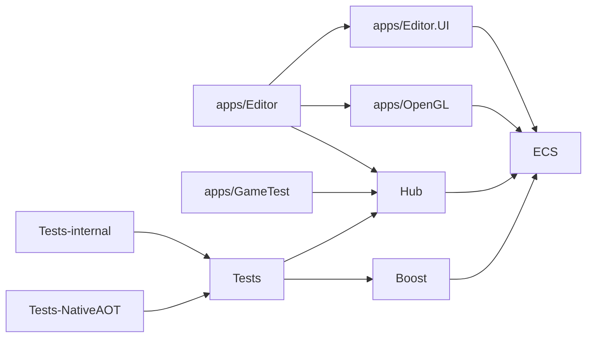

# Friflo.Engine.ECS：当前项目理解

## 范围与证据边界

本文记录现有项目的源码结构、fork 分支的改动来源、上游同步结果和实际测试基线，供后续任务接续阅读。

- 主源码分析基线为 `8e75b6b41f508adde68a2eae0b313c093c5dc098`（[固定提交](https://github.com/friflo/Friflo.Engine.ECS/tree/8e75b6b41f508adde68a2eae0b313c093c5dc098)）。后续已核验的上游 `717caad3ae2b9714d8e35cda08f3f5796204cd7e` 只改动 README 图片 URL，因此本文件所引源码与测试结论仍适用。
- 结论优先来自此仓库的 C#、项目文件和测试；README 与 `docs/Architecture.md` 中的产品愿景会明确标示，不能据此推断未在解决方案中实现的模块。
- 核心库项目声明 `net10.0;net8.0;net7.0;net6.0;netstandard2.1`，并使用 C# 14。本轮已对固定提交的隔离源码快照执行 Release/net8.0 测试，结果与覆盖范围见文末。见 [`src/ECS/Friflo.Engine.ECS.csproj:5-12`](../src/ECS/Friflo.Engine.ECS.csproj#L5-L12)。

## Fork、分支与上游同步

2026-10-07 查询 [GitHub fork 元数据](https://api.github.com/repos/liujianmisaka/Friflo.Engine.ECS)，确认本仓库 `liujianmisaka/Friflo.Engine.ECS` 的 parent/source 均为 `friflo/Friflo.Engine.ECS`。本轮已添加该上游为 `upstream` 并获取远端分支。以下提交号来自本地 Git 对象与远端 fetch 结果。

| 角色 | 固定提交 | 含义 |
| --- | --- | --- |
| fork 的 `origin/main` | `8e75b6b41f508adde68a2eae0b313c093c5dc098` | 本轮开始时的 main |
| 当前本地 `main` / `upstream/main` | `717caad3ae2b9714d8e35cda08f3f5796204cd7e` | 已通过 `git merge --ff-only upstream/main` 同步 |
| 重点分支 `origin/misakaruntime` | `0b4ffa14fca7bd7c6bb262fc67a4173d7c3fece9` | 保留原始版本，未合并或变基 |
| 自定义改动的直接基线 | `f0341fc4430a4f6e0b889bd8ce6836f45703df3d` | 上游 SoA 开发历史的末端 |
| 当前 `upstream/SoA` | `8be06056f6458e95e0485432bd9cdb1623a8860f` | 在该基线上仅增加 `.gitignore` 的 `*.lscache` 规则 |
| main 与 misakaruntime 的共同祖先 | `2036794926418ece4f6f4c4b00cd87a685425766` | 区分 main 与 SoA 两条开发历史的起点 |



同步本地 main 的依据是 `git diff 8e75b6b4 717caad3` 仅替换一处 README 图片 URL，源码、项目文件和测试文件均相同。见 [上游同步提交](https://github.com/friflo/Friflo.Engine.ECS/commit/717caad3ae2b9714d8e35cda08f3f5796204cd7e)。远端 fork 尚未推送，因此本地 main 相对 `origin/main` 领先一项上游提交。

重点分支的比较需分两层：

- `git diff main...origin/misakaruntime` 从共同祖先展示整条 SoA 路线及 fork 改动，当前为 126 个文件、7955 行增加、906 行删除。当前两端独有提交数为 main 9、misakaruntime 84。
- `git diff f0341fc4 origin/misakaruntime` 才是两项 fork 自定义提交的净变化：80 个文件、2238 行增加、630 行删除。后续理解或审查 fork 的类型扩展与稀疏存储时应使用这个基线。

本轮保持 misakaruntime 的原始提交关系，已将上游 SoA 的新增忽略规则记录在这里。分析与测试均针对其原始 `0b4ffa14` 快照。

## 代码地形与依赖方向

解决方案包含 ECS 核心、Boost、Hub、测试、NativeAOT 测试、代码生成器和编辑器/图形/示例项目。完整入口清单见 [`Engine.sln:6-26`](../Engine.sln#L6-L26)。实际项目引用给出如下稳定方向：



这张图来自项目引用，而非架构文档的愿景图：`Editor` 的三个引用见 [`src/apps/Editor/Editor.csproj:33-39`](../src/apps/Editor/Editor.csproj#L33-L39)，`GameTest` 引用 Hub 见 [`src/apps/GameTest/GameTest.csproj:30-34`](../src/apps/GameTest/GameTest.csproj#L30-L34)，测试和核心扩展的引用见 [`src/Tests/Tests.csproj:30-41`](../src/Tests/Tests.csproj#L30-L41)、[`src/ECS.Boost/Friflo.Engine.ECS.Boost.csproj:69`](../src/ECS.Boost/Friflo.Engine.ECS.Boost.csproj#L69)。

`docs/Architecture.md` 画出了 Renderer、Physics、Assets、Netcode 和 ORM/Storage 的更大引擎蓝图，但在当前 `Engine.sln` 中没有同名实现项目；该文件应视为愿景/历史架构材料，而非当前可编译模块目录。对照其总览图和说明：[`docs/Architecture.md:83-164`](Architecture.md#L83-L164)。

## 核心模型：EntityStore、Entity 与 schema

### EntityStore 是运行时所有权边界

`EntityStore` 是密封的 `EntityStoreBase` 实现，持有实体节点数组、树根、ID 回收缓冲、命令缓冲池、事件记录器和扩展状态；基类持有 archetype 数组与按 `ArchetypeKey` 查找的集合。`EntityStore` 暴露 `StoreRoot`、调试向的 `Entities`、事件记录和容量信息；基类暴露 `Count`、`Archetypes`、`JobRunner`、archetype 总容量等。见 [`src/ECS/EntityStore.cs:34-70`](../src/ECS/EntityStore.cs#L34-L70)、[`src/ECS/EntityStore.cs:149-196`](../src/ECS/EntityStore.cs#L149-L196)、[`src/ECS/Archetype/EntityStore.cs:27-89`](../src/ECS/Archetype/EntityStore.cs#L27-L89)。

创建默认使用 `PidType.UsePidAsId`；`RandomPids` 时 PID 到内部 ID 需经过映射。删除 ID 默认可回收，实体句柄由节点 revision 辅助判定存活，避免旧句柄在 ID 回收后被当作新实体。构造、PID/ID 转换与按 ID 取得句柄的实际实现见 [`src/ECS/EntityStore.cs:199-263`](../src/ECS/EntityStore.cs#L199-L263)、[`src/ECS/Entity/EntityNode.cs:43-105`](../src/ECS/Entity/EntityNode.cs#L43-L105)。

`Entity` 是面向调用方的轻量句柄：其 API 直接提供 `GetComponent<T>()` 的 `ref`、增加/删除结构组件、父子树操作与删除。默认实体创建位于 `EntityStore` 的 partial 文件，常用带 1–10 个组件的重载是扩展方法，批量创建另有 `CreateEntityBatch`。见 [`src/ECS/Entity.cs:397-452`](../src/ECS/Entity.cs#L397-L452)、[`src/ECS/Entity.cs:578-617`](../src/ECS/Entity.cs#L578-L617)、[`src/ECS/Entity/Store/Entities.cs:31-69`](../src/ECS/Entity/Store/Entities.cs#L31-L69)、[`src/ECS/Entity/Store/Extensions/CreateEntity.cs:20-262`](../src/ECS/Entity/Store/Extensions/CreateEntity.cs#L20-L262)、[`src/ECS/Batch/CreateEntityBatch.cs:35-263`](../src/ECS/Batch/CreateEntityBatch.cs#L35-L263)。

### Schema 是全局类型目录

`EntitySchema` 汇集可用的组件、关系、标签和脚本，并维护按类型、组件键或标签名的查找表；组件与关系共用 `Components` 目录和 `StructIndex`，脚本、标签使用各自的数组及索引，下标 0 保留为空。关系进入该目录的实际分支见 `SchemaTypes.CreateSchemaTypes`。见 [`src/ECS/Base/EntitySchema.cs:23-65`](../src/ECS/Base/EntitySchema.cs#L23-L65)、[`src/ECS/Base/EntitySchema.cs:96-159`](../src/ECS/Base/EntitySchema.cs#L96-L159)、[`src/ECS/Base/SchemaTypes.cs:54-84`](../src/ECS/Base/SchemaTypes.cs#L54-L84)。

`SchemaTypes` 根据反射发现的类型生成三类 schema type，把带索引/关系的组件排在前面；这也解释了为何核心项目设置了 trimming/AOT 属性、同时将反射路径以抑制属性标注为“不供 NativeAOT 调用”。见 [`src/ECS/Base/SchemaTypes.cs:31-104`](../src/ECS/Base/SchemaTypes.cs#L31-L104)、[`src/ECS/Base/SchemaTypes.cs:131-168`](../src/ECS/Base/SchemaTypes.cs#L131-L168)、[`src/ECS/Friflo.Engine.ECS.csproj:14-16`](../src/ECS/Friflo.Engine.ECS.csproj#L14-L16)。

`ComponentTypes` 与 `Tags` 都是基于位集的值类型集合，可做 `HasAll`/`HasAny`、合并、增删和由泛型实参构造；它们同时是创建 archetype 与 query 过滤的公共语言。见 [`src/ECS/Archetype/ComponentTypes.cs:29-62`](../src/ECS/Archetype/ComponentTypes.cs#L29-L62)、[`src/ECS/Archetype/ComponentTypes.cs:217-329`](../src/ECS/Archetype/ComponentTypes.cs#L217-L329)、[`src/ECS/Archetype/Tags.cs:48-142`](../src/ECS/Archetype/Tags.cs#L48-L142)。

## 内存布局与结构变更：Archetype、StructHeap

一个 `Archetype` 表示完全相同的结构组件集合和标签集合，持有实体 ID 的连续数组、每个结构组件的 heap 映射、组件类型/标签以及 chunk 容量信息；它可创建实体，结构变更时由 `MoveEntityTo` 把实体移至目标 archetype，并复制共同组件。见 [`src/ECS/Archetype/Archetype.cs:33-117`](../src/ECS/Archetype/Archetype.cs#L33-L117)、[`src/ECS/Archetype/Archetype.cs:241-359`](../src/ECS/Archetype/Archetype.cs#L241-L359)。

`StructHeap` 是每种结构组件存储的抽象接口；泛型实现 `StructHeap<T>` 以 `T[] components` 存值，并提供扩缩容、移动、跨 archetype 复制、JSON 读写与索引更新等操作。查询侧的 `Chunk<T>.Span` 通过数组、start、Length 构造组件区间视图。见 [`src/ECS/Archetype/StructHeap.cs:25-55`](../src/ECS/Archetype/StructHeap.cs#L25-L55)、[`src/ECS/Archetype/StructHeap.generic.cs:34-147`](../src/ECS/Archetype/StructHeap.generic.cs#L34-L147)、[`src/ECS/Query/Chunk.cs:30-42`](../src/ECS/Query/Chunk.cs#L30-L42)。

仓库还保留了旧 `StructChunk<T>`：它只保存一个 `T[]`，已标记 `[Obsolete("replaced by StructHeap<T>.components")]`。理解现行查询区间时应读取 `Query/Chunk.cs`。见 [`src/ECS/Archetype/StructChunk.cs:11-28`](../src/ECS/Archetype/StructChunk.cs#L11-L28)。

因此当前实现是 archetype/列式数组的 ECS：结构组件随 archetype 迁移；脚本、树、索引、关系和事件各走相应附属存储。README 对“连续内存”和 cache locality 的描述与这部分实现一致，但性能数字属于产品声明，不能由静态阅读确认。参照 [`README.md:16-31`](../README.md#L16-L31)。

## 查询、并行和延迟写入

`EntityStoreBase.Query()` 提供无类型和 1–5 个结构组件的泛型 `ArchetypeQuery`；签名与 `QueryFilter` 是筛选条件。具体泛型 query 将匹配到的 archetype 按 `Chunk<T>` 和 `ChunkEntities` 交给 `ForEach`，并由对应 `QueryJob<T...>` 执行。入口与生成后的 1 元实现见 [`src/ECS/Query/EntityStore.Query.cs:44-247`](../src/ECS/Query/EntityStore.Query.cs#L44-L247)、[`src/ECS/Query/ArchetypeQuery.cs:20-124`](../src/ECS/Query/ArchetypeQuery.cs#L20-L124)、[`src/ECS/Query/Arg.1/Query.cs:20-67`](../src/ECS/Query/Arg.1/Query.cs#L20-L67)。

`QueryJob` 抽象出 `Run()`，`ParallelJobRunner` 负责查询作业的并行执行资源；store 的 `JobRunner` 是可初始化的默认 runner。当前公开泛型 query 的 2–5 元源文件由 `src/CodeGen/Program.cs` 生成，生成器将结果写入 `src/ECS/Query/Arg.2` 至 `Arg.5`。见 [`src/ECS/Query/QueryJob.cs:19-54`](../src/ECS/Query/QueryJob.cs#L19-L54)、[`src/ECS/Query/ParallelJobRunner.cs:51-137`](../src/ECS/Query/ParallelJobRunner.cs#L51-L137)、[`src/ECS/Archetype/EntityStore.cs:34-37`](../src/ECS/Archetype/EntityStore.cs#L34-L37)、[`src/CodeGen/Program.cs:10-28`](../src/CodeGen/Program.cs#L10-L28)。

遍历期间的结构变化应交由 `CommandBuffer`：它记录组件、标签、脚本、树和实体命令，API 文档约定在主线程执行 `Playback()`；实现通过活动 query loop 计数显式拒绝遍历期间回放。回放顺序是实体、标签、结构组件准备/迁移/写入、脚本、树，再发送事件。普通 buffer 不线程安全；并行 query 应使用 `Synced` 包装。见 [`src/ECS/CommandBuffer/CommandBuffer.cs:20-56`](../src/ECS/CommandBuffer/CommandBuffer.cs#L20-L56)、[`src/ECS/CommandBuffer/CommandBuffer.cs:140-201`](../src/ECS/CommandBuffer/CommandBuffer.cs#L140-L201)、[`src/ECS/CommandBuffer/CommandBuffer.cs:308-346`](../src/ECS/CommandBuffer/CommandBuffer.cs#L308-L346)。

## Systems、索引与关系

系统层是独立于 query API 的编排层：`BaseSystem` 是共同基类，`SystemGroup` 以可嵌套组维护并 `Update(UpdateTick)` 成员，`SystemRoot` 是根组，`QueryBaseSystem` 为 query 驱动系统提供基类。对应实现和单元测试入口见 [`src/ECS/Systems/BaseSystem.cs:13-142`](../src/ECS/Systems/BaseSystem.cs#L13-L142)、[`src/ECS/Systems/SystemGroup.cs:27-124`](../src/ECS/Systems/SystemGroup.cs#L27-L124)、[`src/ECS/Systems/SystemGroup.cs:259-302`](../src/ECS/Systems/SystemGroup.cs#L259-L302)、[`src/ECS/Systems/SystemRoot.cs:21-85`](../src/ECS/Systems/SystemRoot.cs#L21-L85)、[`src/ECS/Systems/QueryBaseSystem.cs:13-99`](../src/ECS/Systems/QueryBaseSystem.cs#L13-L99)。

索引由组件类型声明 `IIndexedComponent<TValue>`，运行时以 `ComponentIndex<TComponent,TValue>` 等类型维护按值找实体的结构；`ILinkComponent` 是值为 `Entity` 的专门索引，提供反向入链查询。调用层使用 `GetEntitiesWithComponentValue`、`GetAllIndexedComponentValues` 与 `GetIncomingLinks`。见 [`src/ECS/Index/IIndexedComponent.cs:9-38`](../src/ECS/Index/IIndexedComponent.cs#L9-L38)、[`src/ECS/Index/ComponentIndex.cs:13-40`](../src/ECS/Index/ComponentIndex.cs#L13-L40)、[`src/ECS/Index/ILinkComponent.cs:13-31`](../src/ECS/Index/ILinkComponent.cs#L13-L31)、[`src/ECS/Index/IndexExtensions.cs:24-119`](../src/ECS/Index/IndexExtensions.cs#L24-L119)。

关系是另一套“同类型可多条”的模型：`IRelation<TKey>` 用键定义每个实体内的唯一 relation，`ILinkRelation` 以 `Entity` 为键。`GetRelations` 为实体提供带版本检查的视图，`EntityRelations<T>` 可得到拥有该类 relation 的实体集，或高效遍历全量 `(Entities, Chunk<TRelation>)` pairs；入链可按目标实体取得。见 [`src/ECS/Relations/IRelation.cs:7-38`](../src/ECS/Relations/IRelation.cs#L7-L38)、[`src/ECS/Relations/ILinkRelation.cs:14-24`](../src/ECS/Relations/ILinkRelation.cs#L14-L24)、[`src/ECS/Relations/RelationExtensions.cs:14-149`](../src/ECS/Relations/RelationExtensions.cs#L14-L149)、[`src/ECS/Relations/EntityRelations.cs:13-45`](../src/ECS/Relations/EntityRelations.cs#L13-L45)、[`src/ECS/Relations/Relations.cs:13-128`](../src/ECS/Relations/Relations.cs#L13-L128)。

## 序列化与 Hub

`DataEntity` 是稳定外部表示：包含 permanent `pid`、有序 `children`、JSON `components`、tags 以及 scene/prefab/modify 字段。`EntitySerializer` 可整体读写 store、实体集合或单实体；`EntityConverter` 在运行时实体与 `DataEntity` 间转换。写入器按 schema key 写结构组件、关系和脚本；读取器会根据 JSON payload 先构造/寻找目标 archetype，再批量迁移以避免逐组件的结构变更，并把未知键纳入 `Unresolved`。见 [`src/ECS/Serialize/DataEntity.cs:17-69`](../src/ECS/Serialize/DataEntity.cs#L17-L69)、[`src/ECS/Serialize/EntitySerializer.cs:23-129`](../src/ECS/Serialize/EntitySerializer.cs#L23-L129)、[`src/ECS/Serialize/EntitySerializer.cs:265-356`](../src/ECS/Serialize/EntitySerializer.cs#L265-L356)、[`src/ECS/Serialize/EntityConverter.cs:15-89`](../src/ECS/Serialize/EntityConverter.cs#L15-L89)、[`src/ECS/Serialize/ComponentWriter.cs:18-95`](../src/ECS/Serialize/ComponentWriter.cs#L18-L95)、[`src/ECS/Serialize/ComponentReader.cs:99-240`](../src/ECS/Serialize/ComponentReader.cs#L99-L240)。

Hub 是已在解决方案中存在的同步/服务适配层，依赖 ECS 和 `Friflo.Json.Fliox.Hub`。`StoreClient` 定义 `DataEntity` 的 entity set 与 `store.*` 命令；`StoreCommands` 在 `StoreDispatcher` 主线程约束下执行加入和读取实体；`StoreSync` 负责通过 `EntityConverter` 在 store 与 Fliox client 之间加载、上载和订阅变更。见 [`src/Hub/Engine.Hub.csproj:5-38`](../src/Hub/Engine.Hub.csproj#L5-L38)、[`src/Hub/StoreClient.cs:15-34`](../src/Hub/StoreClient.cs#L15-L34)、[`src/Hub/StoreCommands.cs:17-99`](../src/Hub/StoreCommands.cs#L17-L99)、[`src/Hub/StoreSync.cs:18-195`](../src/Hub/StoreSync.cs#L18-L195)。

这里应避免把架构文档中的 `EntityStoreSync` 当作当前类名：实际源码/测试中是 `StoreSync`，而 `docs/Architecture.md` 使用了较早或概念性的命名。比较 [`docs/Architecture.md:316-350`](Architecture.md#L316-L350) 与 [`src/Hub/StoreSync.cs:18-62`](../src/Hub/StoreSync.cs#L18-L62)。

## Boost、CodeGen 与 apps

`ECS.Boost` 是核心库的可选性能扩展，项目引用核心并允许 unsafe code；其 README 明确将目的限定为去除大 query 结果集的数组边界检查，给出约 30% 的性能宣称。实际代码位于 `Chunk/Extensions.*.cs`、`Query/Extensions.*.cs`，测试位于 `src/Tests/Boost/`。见 [`src/ECS.Boost/Friflo.Engine.ECS.Boost.csproj:5-13`](../src/ECS.Boost/Friflo.Engine.ECS.Boost.csproj#L5-L13)、[`src/ECS.Boost/README.md:9-18`](../src/ECS.Boost/README.md#L9-L18)、[`src/Tests/Boost/Test_Query_Each.cs:9-127`](../src/Tests/Boost/Test_Query_Each.cs#L9-L127)。

`CodeGen` 是 net8 控制台工具，专门生成 2–5 元 query 的 `IEach`、`Query`、`Query.Chunks`、`QueryJob` 源文件；它不是运行时依赖。见 [`src/CodeGen/CodeGen.csproj:3-13`](../src/CodeGen/CodeGen.csproj#L3-L13)、[`src/CodeGen/Program.cs:10-28`](../src/CodeGen/Program.cs#L10-L28)。

`apps/Editor` 是 Avalonia WinExe，组合 Editor.UI、OpenGL 和 Hub；它的 `Program` 实际启动 Avalonia desktop lifetime。`apps/OpenGL` 是引用 Silk.NET.OpenGL 与 ImageSharp 的库，`apps/GameTest` 是 net8 可执行项目，当前 `Main` 调用 `ParallelQuery.Query_ForEach`。它们是现有演示/工具入口，不能由名称推断为完整 Renderer 或游戏产品。见 [`src/apps/Editor/Editor.csproj:3-60`](../src/apps/Editor/Editor.csproj#L3-L60)、[`src/apps/Editor/Program.cs:19-69`](../src/apps/Editor/Program.cs#L19-L69)、[`src/apps/OpenGL/Engine.OpenGL.csproj:3-32`](../src/apps/OpenGL/Engine.OpenGL.csproj#L3-L32)、[`src/apps/GameTest/Program.cs:11-19`](../src/apps/GameTest/Program.cs#L11-L19)。

## 测试入口与后续验证定位

常规回归入口是 `src/Tests/Tests.csproj`：NUnit 3 + NUnit3 adapter + Microsoft.NET.Test.Sdk，且直接覆盖 Boost 与 Hub。`src/Tests-internal` 在此基础上继续添加白盒/内部测试；二者都是 net8。见 [`src/Tests/Tests.csproj:3-41`](../src/Tests/Tests.csproj#L3-L41)、[`src/Tests-internal/Tests-internal.csproj:3-36`](../src/Tests-internal/Tests-internal.csproj#L3-L36)。

建议在未来有具体改动时按受影响模块缩小入口：

- store/entity/archetype/heap：`src/Tests/ECS/Arch/`、`src/Tests/ECS/Entity/`，并补充 `src/Tests-internal/ECS/Test_Archetype.cs`、`Test_StructHeap.cs`；例如 [`src/Tests/ECS/Entity/Test_StructHeap.cs:13-64`](../src/Tests/ECS/Entity/Test_StructHeap.cs#L13-L64)。
- query/system/命令缓冲：`src/Tests/ECS/Systems/`、`src/Tests/ECS/Arch/`、`src/Tests-internal/ECS/Test_Query.cs` 与 `Test_CommandBuffer.cs`；例如 [`src/Tests/ECS/Systems/Test_Query.cs:10-54`](../src/Tests/ECS/Systems/Test_Query.cs#L10-L54)。
- index/relations/serialization/Hub：对应 `src/Tests/ECS/Index/`、`Relations/`、`Serialize/` 和 `src/Tests/Hub/`；例如 [`src/Tests/ECS/Relations/Test_Relations.cs:17-79`](../src/Tests/ECS/Relations/Test_Relations.cs#L17-L79)、[`src/Tests/Hub/Test_StoreSync.cs:26-110`](../src/Tests/Hub/Test_StoreSync.cs#L26-L110)。
- AOT：`src/Tests-NativeAOT` 使用 MSTest source generation 和 NativeAOT publish；README 给出了命令行 publish/run 路径，Unity 则将测试符号链接进 EditMode。见 [`src/Tests-NativeAOT/Tests-NativeAOT.csproj:3-50`](../src/Tests-NativeAOT/Tests-NativeAOT.csproj#L3-L50)、[`src/Tests-NativeAOT/README.md:8-24`](../src/Tests-NativeAOT/README.md#L8-L24)、[`src/Tests-Unity/README.md:28-52`](../src/Tests-Unity/README.md#L28-L52)。

## misakaruntime 的两项自定义改动

SoA、AoS/AoSoA vector heap、SIMD lane 访问、32 字节对齐和相应 query/Boost 变化来自该分支此前的上游开发历史。对照 [自定义基线树](https://github.com/friflo/Friflo.Engine.ECS/tree/f0341fc4430a4f6e0b889bd8ce6836f45703df3d/src/ECS/Archetype/StructHeap) 与两项 fork 提交，应将这些既有实验能力与以下变化分别理解。

### 9a3426ed：类型容量扩展

[该提交](https://github.com/liujianmisaka/Friflo.Engine.ECS/commit/9a3426eda3e8c2099f40613748cac5c0b2786ccd) 将固定 256 位与 byte 类型索引相关路径扩展到 ushort 范围：

- `SchemaTypeIndex.Next` 统一登记上限，注册索引为 1..65535；组件与关系共享计数，标签和脚本分别计数。`SignatureIndexes` 与 `TypeCache` 使用 ushort 保存索引，并校验转换。见 [SchemaTypeIndex](https://github.com/liujianmisaka/Friflo.Engine.ECS/blob/0b4ffa14fca7bd7c6bb262fc67a4173d7c3fece9/src/ECS/Base/SchemaTypeIndex.cs#L9-L23)、[SchemaTypes](https://github.com/liujianmisaka/Friflo.Engine.ECS/blob/0b4ffa14fca7bd7c6bb262fc67a4173d7c3fece9/src/ECS/Base/SchemaTypes.cs)、[SignatureIndexes](https://github.com/liujianmisaka/Friflo.Engine.ECS/blob/0b4ffa14fca7bd7c6bb262fc67a4173d7c3fece9/src/ECS/Query/Signature.Indexes.cs)。
- `BitSet` 保留低 256 位内联区，高位由排序的 `BitSetBlock[]` 保存；修改已有高位 block 时复制数组，保持值复制之后的独立行为。`ComponentTypes`、`Tags`、集合运算及枚举一起覆盖高位。见 [BitSet](https://github.com/liujianmisaka/Friflo.Engine.ECS/blob/0b4ffa14fca7bd7c6bb262fc67a4173d7c3fece9/src/ECS/Utils/BitSet.cs#L15-L122)、[BitSet.operations](https://github.com/liujianmisaka/Friflo.Engine.ECS/blob/0b4ffa14fca7bd7c6bb262fc67a4173d7c3fece9/src/ECS/Utils/BitSet.operations.cs)。
- `EntityTypeTracking` 让 owner/incoming-link 的低 32 位继续留在 `EntityNode`，高类型编号存入 store 的稀疏字典，并在实体删除、索引和关系清理时共同处理。见 [EntityTypeTracking](https://github.com/liujianmisaka/Friflo.Engine.ECS/blob/0b4ffa14fca7bd7c6bb262fc67a4173d7c3fece9/src/ECS/Entity/Store/EntityTypeTracking.cs)、[NodeTree 删除路径](https://github.com/liujianmisaka/Friflo.Engine.ECS/blob/0b4ffa14fca7bd7c6bb262fc67a4173d7c3fece9/src/ECS/Entity/Store/NodeTree.cs#L519-L618)。
- 反射发现的 assembly/type 按 `FullName` 排序；null 索引值和查询范围缓存的删除路径也有相关修正。见 [AssemblyLoader](https://github.com/liujianmisaka/Friflo.Engine.ECS/blob/0b4ffa14fca7bd7c6bb262fc67a4173d7c3fece9/src/ECS/Base/AssemblyLoader.cs)、[索引删除回归](https://github.com/liujianmisaka/Friflo.Engine.ECS/blob/0b4ffa14fca7bd7c6bb262fc67a4173d7c3fece9/src/Tests/ECS/Index/Test_Index_Delete.cs)。

布局上的实际变化是 x64 下 `BitSet`、`Tags`、`ComponentTypes` 从 32 字节变为 40 字节，`EntityNode` 仍为 24 字节。已有 sizeof 测试明确验证这些数值。见 [分支布局测试](https://github.com/liujianmisaka/Friflo.Engine.ECS/blob/0b4ffa14fca7bd7c6bb262fc67a4173d7c3fece9/src/Tests-internal/ECS/Test_sizeof.cs#L17-L70)。

### 0b4ffa14：稀疏存储、池清理与 ID 同步

[该提交](https://github.com/liujianmisaka/Friflo.Engine.ECS/commit/0b4ffa14fca7bd7c6bb262fc67a4173d7c3fece9) 处理类型容量扩展后，按全 schema 长度为每个使用者分配 lookup 数组的成本：

- 不可变 `StructHeapMap` 替代 archetype 的全长 heap 映射。低编号按实际所需长度分配直接数组，高编号排序后以二分查找定位。见 [StructHeapMap](https://github.com/liujianmisaka/Friflo.Engine.ECS/blob/0b4ffa14fca7bd7c6bb262fc67a4173d7c3fece9/src/ECS/Archetype/StructHeap/StructHeapMap.cs)。
- 可变 `TypeIndexSlotMap<TSlot>` 为 entity/create batch、command buffer 提供低位懒扩容及高位稀疏查找，并保留 slot 供池化复用。两种 map 的内联分界均为 256。见 [TypeIndexSlotMap](https://github.com/liujianmisaka/Friflo.Engine.ECS/blob/0b4ffa14fca7bd7c6bb262fc67a4173d7c3fece9/src/ECS/Utils/TypeIndexSlotMap.cs)。
- batch 的 Clear/Remove/Return 和 command buffer 的 Clear/Playback/Return 清除被保留的托管引用，复用 slot/数组；`ReturnBuffer()` 明确清除未执行的命令。见 [EntityBatch](https://github.com/liujianmisaka/Friflo.Engine.ECS/blob/0b4ffa14fca7bd7c6bb262fc67a4173d7c3fece9/src/ECS/Batch/EntityBatch.cs)、[CommandBuffer.Reset/ReturnBuffer](https://github.com/liujianmisaka/Friflo.Engine.ECS/blob/0b4ffa14fca7bd7c6bb262fc67a4173d7c3fece9/src/ECS/CommandBuffer/CommandBuffer.cs#L98-L220)、[ComponentCommands.Reset](https://github.com/liujianmisaka/Friflo.Engine.ECS/blob/0b4ffa14fca7bd7c6bb262fc67a4173d7c3fece9/src/ECS/CommandBuffer/Commands/ComponentCommands.cs#L183-L191)。
- 多个 buffer 预留实体 ID 时调用 store 的 `NewIdSynced()`，共用 `idAllocationLock`，使不同 `Synced` buffer 的并行登记也共用同一锁。该变化覆盖 ID 预留，不代表所有 EntityStore 操作都变为线程安全。见 [NewIdSynced](https://github.com/liujianmisaka/Friflo.Engine.ECS/blob/0b4ffa14fca7bd7c6bb262fc67a4173d7c3fece9/src/ECS/Entity/Store/NodeTree.cs#L512-L517)、[并行 buffer 回归](https://github.com/liujianmisaka/Friflo.Engine.ECS/blob/0b4ffa14fca7bd7c6bb262fc67a4173d7c3fece9/src/Tests-internal/ECS/Test_SparseTypeSlotOwners.cs#L123-L147)。

高位边界、值复制、slot 复用、引用释放和多 buffer ID 唯一性已有测试。本轮通过这些现有回归；未实际注册 65535 个不同 schema 类型，未进行大规模实体场景或性能对比测量。容量上限与稀疏结构的源码结论应与实际规模/性能结论区分。相关入口：[BitSet 边界](https://github.com/liujianmisaka/Friflo.Engine.ECS/blob/0b4ffa14fca7bd7c6bb262fc67a4173d7c3fece9/src/Tests/ECS/Base/Test_BitSet.cs#L125-L172)、[StructHeapMap](https://github.com/liujianmisaka/Friflo.Engine.ECS/blob/0b4ffa14fca7bd7c6bb262fc67a4173d7c3fece9/src/Tests-internal/ECS/Test_StructHeapMap.cs)、[TypeIndexSlotMap](https://github.com/liujianmisaka/Friflo.Engine.ECS/blob/0b4ffa14fca7bd7c6bb262fc67a4173d7c3fece9/src/Tests-internal/ECS/Test_TypeIndexSlotMap.cs)、[SparseTypeSlotOwners](https://github.com/liujianmisaka/Friflo.Engine.ECS/blob/0b4ffa14fca7bd7c6bb262fc67a4173d7c3fece9/src/Tests-internal/ECS/Test_SparseTypeSlotOwners.cs)。

## 2026-10-07 实际验证基线

使用 `git archive` 导出精确 main/分支提交到临时目录；两个快照均保留原始项目文件与语言版本。独立安装的 SDK 为 10.0.401，安装包 SHA512 已与 [Microsoft 官方 10.0 发布清单](https://builds.dotnet.microsoft.com/dotnet/release-metadata/10.0/releases.json) 的对应项核对。测试运行使用 .NET 8.0.20；本机已有的 .NET 8 runtime 复制到临时工具链，未改动系统 SDK 安装。

每个快照均执行以下两条测试命令。重放 main 的例子如下；验证另一端时将快照及结果目录分别改为 `misakaruntime-0b4ffa14` 和 `misakaruntime-results`：

```powershell
$taskEvidenceRoot = 'C:\Users\toophy\AppData\Local\Temp\codex-friflo-understanding-20261007-1f71faf4'
$taskDotnet = Join-Path $taskEvidenceRoot 'dotnet/dotnet.exe'
$taskSnapshot = Join-Path $taskEvidenceRoot 'main-717caad3'
$taskResults = Join-Path $taskEvidenceRoot 'main-results'
& $taskDotnet test (Join-Path $taskSnapshot 'src/Tests/Tests.csproj') -c Release -f net8.0 --nologo --verbosity minimal --logger 'trx;LogFileName=public.trx' --results-directory $taskResults
& $taskDotnet test (Join-Path $taskSnapshot 'src/Tests-internal/Tests-internal.csproj') -c Release -f net8.0 --nologo --verbosity minimal --logger 'trx;LogFileName=internal.trx' --results-directory $taskResults
```

| 固定提交 | 测试项目 | 通过 | 失败 | 跳过 |
| --- | --- | ---: | ---: | ---: |
| main `717caad3` | Tests | 656 | 0 | 0 |
| main `717caad3` | Tests-internal | 133 | 0 | 1 |
| misakaruntime `0b4ffa14` | Tests | 758 | 0 | 0 |
| misakaruntime `0b4ffa14` | Tests-internal | 162 | 0 | 1 |

四次 `dotnet test` 均退出 0。两端同一内部测试 `Test_EntityStore_DeleteEntity` 带有现存 `[Ignore("check EntityStore.RemoveChildNode()")]`，未被执行。成功/跳过数从 TRX 的 UnitTestResult outcome 读取。测试数量差异涵盖 SoA 历史和 fork 改动，不能全部归为两项自定义提交。覆盖范围为 Release/net8.0 下公共、Boost/Hub 及内部回归；其他目标框架、NativeAOT、Unity、编辑器 GUI 和生产性能未在本轮执行。

证据目录：`C:\Users\toophy\AppData\Local\Temp\codex-friflo-understanding-20261007-1f71faf4`。其中 `main-results/`、`misakaruntime-results/` 保存各自的 public/internal.log 和 public/internal.trx，源码快照为 `main-717caad3/`、`misakaruntime-0b4ffa14/`。这些临时快照及 SDK 是可删除的验证材料，不是项目的活动源码或运行依赖；删除会失去原始日志、快照和本轮临时测试工具链，仓库源码与本记录不受影响。

| git archive 文件 | SHA256 |
| --- | --- |
| main.zip | `0D821669D718E279662D46E5434E669ADA7252DCB37177119566CDD7F641BC58` |
| misakaruntime.zip | `5C1C52321732B4699B895E055C44705BC2D82B637B3DA1277C828F88F043FF55` |

后续任务先核对当前 HEAD、重点分支提交和上游状态，再按所改模块选择验证入口。本文提供本轮固定快照的理解与实际结果。
